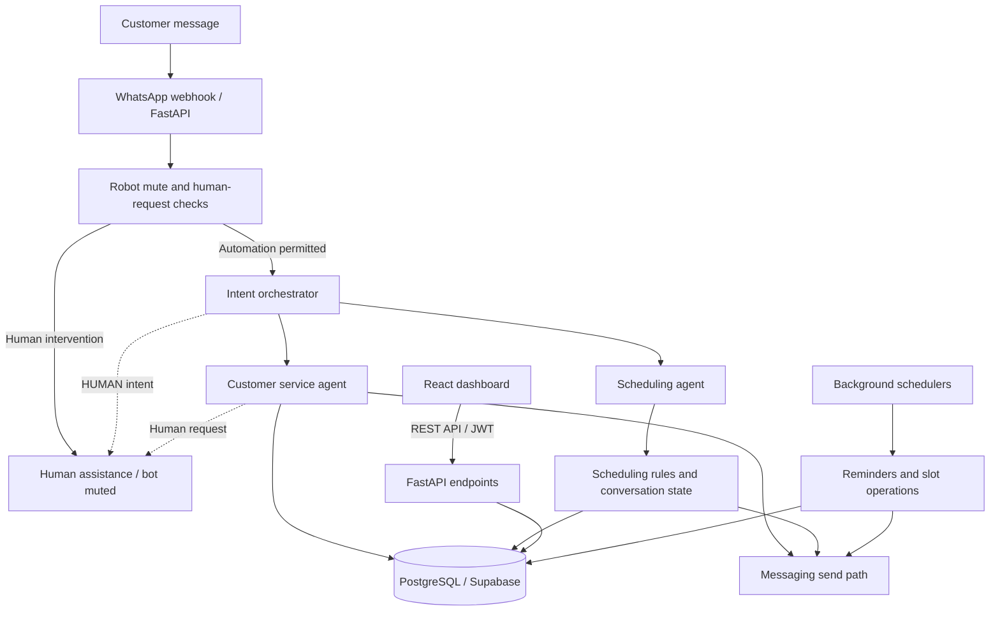
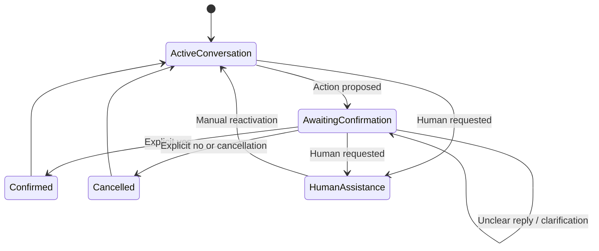

# NEXMAGNI Flow

### AI Automation · Intelligent Agents · Python Backend Engineering

**A multi-tenant business communication and scheduling platform built with Python, FastAPI, React, and PostgreSQL.**

NEXMAGNI Flow is an engineering portfolio based on a privately developed SaaS application for appointment-based businesses. It demonstrates how specialized conversational agents, deterministic business rules, background jobs, and human intervention controls can work together in business automation.

**Engineering focus:** LLM-assisted intent routing · Stateful workflows · Rule-gated actions · Human-in-the-loop · API integrations · Automated testing

**Portfolio scope:** The complete application is private. This repository is being prepared to publish architecture documentation, reviewed interface media, and three independently rewritten, testable engineering examples. The examples are implemented and tested locally but **not yet published**.

**Languages:** English (this file) · [Português (Brasil)](README.pt-BR.md).

---

## 1. What the Application Does

The underlying application supports business communication and appointment operations through an administrative dashboard and a Python API. Its implemented areas include:

- **Customer communication:** conversational customer service and scheduling flows.
- **Appointment workflows:** multi-step conversations, confirmations, session expiration, and recovery from repeated failed attempts.
- **Business administration:** company and service configuration, scheduling views, customer information, and CRM-related interfaces.
- **Background automation:** reminder scheduling, slot generation, and a communication decision engine operating in shadow mode.
- **Human intervention:** detection of requests for a human operator and controls for pausing automated replies.
- **Multi-tenant logic:** business-aware application filtering, including `empresa_id`.

The presence of a component in a deployed codebase does **not** imply that every end-to-end workflow has been production-validated. See [Implementation Status](#9-implementation-status).

## 2. Architecture

| Area | Implementation |
| --- | --- |
| Frontend | React 19, JavaScript/JSX, Vite, Tailwind CSS, TanStack Query, React Router |
| Backend | Python, FastAPI (ASGI), REST APIs |
| Conversational AI | Google Gemini via `google-genai`, an intent orchestrator, specialized service and scheduling agents |
| Database | PostgreSQL / Supabase, versioned SQL migrations |
| Messaging | WhatsApp integration; direct Z-API sending in the deployed path |
| Background processing | Reminder and slot schedulers; communication decision engine (shadow mode) |
| Hosting | Vercel frontend; Render backend |
| Verification | Python automated tests and isolated component checks |

*Conceptual view of the deployed system, not a complete call graph. Newer local-only safeguards, including a pre-send mute recheck and conversation-level locking, are described separately below. Provider abstraction exists in the communication decision engine; the deployed send path uses Z-API directly.*

## 3. AI Orchestration and Specialized Agents

**The model helps interpret; application logic controls operational actions.** The orchestrator combines deterministic checks with LLM-assisted classification into **four permitted intent categories**. It uses up to **three attempts**, with a **one-second wait** between attempts, and a fallback route when classification fails or returns an unexpected label.

The **customer service agent** uses registered business information for services and pricing and detects requests for human assistance. The **scheduling agent** manages a stateful conversation, including a **30-minute session timeout** and recovery from repeated failed attempts.

These are deployed code capabilities. They should not be mistaken for a claim that all conversation paths have passed full end-to-end production acceptance testing.

## 4. Deterministic Interpretation and Rule-Gated Actions

The deployed application already includes deterministic routing checks and operational conversation rules. More advanced interpretation was subsequently developed in the local backend branch:

| Behavior | Status |
| --- | --- |
| Deterministic pre-routing checks and session recovery | ✅ Deployed |
| Advanced handling of negation, hypothetical wording, and ambiguous yes/no responses | 🧪 Local, tested; not deployed |
| More precise cancellation and reminder-response interpretation | 🧪 Local, tested; not deployed |

The design separates **message interpretation** from **permission to perform an action**. A model-generated response is not equivalent to a validated business decision; the system uses explicit application rules where required.

## 5. Human-in-the-Loop and Concurrency

The deployed backend has a **binary robot-mute control** and supports human takeover with **manual reactivation from the dashboard**. In the deployed version, reactivation is not exclusively manual because scheduling code can also clear the mute state. It does not implement the newer three-state fail-closed mechanism.

The local, not-yet-deployed implementation adds:

- **Active / muted / unknown** operational states, with unknown treated as blocked.
- **Fail-closed** behavior when automation permission cannot be confirmed.
- **Conversation-level locking** to reduce concurrent processing conflicts.
- **A mute-state recheck before sending** a message.

These are 🧪 **implemented and tested locally**, not production capabilities. The public portfolio will demonstrate their engineering concepts using independent, in-memory examples rather than the proprietary production implementation.

## 6. Stateful Scheduling and Background Automation

Scheduling is not a single LLM response. It requires continuity across messages, explicit confirmation, session management, and coordination with background work.

*Simplified illustration of conversational concepts, not the private scheduling state machine. Advanced ambiguity handling shown here is local-only (🧪), not a claim about the deployed parser.*

The backend also contains **reminder scheduling**, **slot scheduling**, and a **communication decision engine (shadow mode)**. The shadow-mode engine evaluates appointments and logs messaging decisions without sending messages. These components have distinct operational and validation boundaries.

## 7. Integrations, Tenancy, and Security Boundaries

- **Messaging:** the deployed WhatsApp send path uses Z-API directly. A broader provider abstraction exists in the communication decision engine (shadow mode); it is not the universal deployed send mechanism.
- **Providers:** a Meta provider component exists but remains **partial (🟡)** and is not connected through the complete factory path.
- **Secrets:** the backend includes a Supabase Vault secret-store component. This does not establish that every configuration value is securely provisioned in every environment.
- **Onboarding:** the application contains business onboarding and configuration flows.
- **Tenant filtering:** isolation depends primarily on application logic and `empresa_id` filtering.

**Important RLS limitation:** RLS is enabled on **23 tables**, but the audited configuration has **no tenant-isolation policies**, and the backend connection can bypass RLS. It would be incorrect to claim that RLS currently enforces tenant separation. This is a known security boundary, not a certification of tenant isolation.

## 8. Verification and Engineering Evidence

The technical audit identified the following inventory:

| Evidence | Scope |
| --- | --- |
| **158** test files | Backend test inventory |
| **Approximately 2,800** test functions | Static identification; **not** all executed or confirmed passing |
| **613 passing tests** | Previously reported isolated runs on the **local backend tree**, including pending changes (November 2026); **not** a full production validation |
| **17** versioned SQL migrations | Database migration inventory |

The public examples have their **own** isolated pytest suites, with fictional data, fake dependencies, no production credentials, and no network requirement. In local runs, all tests passed: **545** (`deterministic_intent`), **364** (`guarded_llm_router`), and **188** (`hitl_fail_closed`). See [section 10](#10-public-engineering-examples).

## 9. Implementation Status

| Indicator | Meaning |
| --- | --- |
| ✅ | Present in the deployed code/version; **not necessarily end-to-end production validated** |
| 🧪 | Implemented and tested locally; not deployed |
| 🟡 | Partially implemented or limited to a non-live/shadow-mode path |
| 📋 | Planned for the public portfolio |

| Capability | Status |
| --- | --- |
| React administrative dashboard and API connectivity | ✅ |
| Intent orchestrator and specialized conversational agents | ✅ |
| Scheduling sessions, timeout, and anti-loop handling | ✅ |
| Reminder and slot schedulers | ✅ |
| Existing binary mute and human-assistance handling | ✅ |
| Communication decision engine (shadow mode): evaluates appointments and logs messaging decisions without sending | 🟡 |
| Advanced deterministic intent interpretation | 🧪 |
| Three-state fail-closed HITL, enforced manual-only reactivation, and pre-send recheck | 🧪 |
| Conversation-level advisory locking | 🧪 |
| Recent Meta webhook HMAC protection | 🧪 |
| MetaProvider integration | 🟡 |
| Three independent public code examples (tested locally; not yet published) | 🧪 |
| Privacy-reviewed interface GIF | 📋 |

Newer backend changes are not yet deployed. Their protections must not be represented as active in the Render deployment. Frontend deployment and health/connectivity checks do not establish full system-wide acceptance testing.

## 10. Public Engineering Examples

The complete application, its proprietary prompts, scheduling rules, internal configuration, and production integrations remain private. Three **independently rewritten** examples have been implemented and tested locally for this public repository:

| Example | What it demonstrates | Dependencies | Local tests |
| --- | --- | --- | --- |
| [`examples/deterministic_intent/`](examples/deterministic_intent/) | Yes/no, cancellation, negation, uncertainty, and reminder-response classification | Python standard library + pytest | 545 passed |
| [`examples/guarded_llm_router/`](examples/guarded_llm_router/) | Restricted labels, deterministic prechecks, injected fake LLM, retries, and fallback | Python standard library + pytest | 364 passed |
| [`examples/hitl_fail_closed/`](examples/hitl_fail_closed/) | Active/muted/unknown states, fail-closed handling, in-memory per-conversation locks, pre-send recheck | Python standard library + pytest | 188 passed |

**These examples are implemented and tested locally but not yet published.** They use new code and fictional data, not copied proprietary files. No API keys, external SDKs, live database, or paid services are required to run their tests. The test suites were executed on Python 3.14; Python 3.10+ compatibility was verified syntactically only.

## 11. Interface Preview (Planned)

The administrative interface includes company and service management, scheduling-related views, and CRM-related functionality. A short, silent **ScreenToGif** walkthrough and selected screenshots are planned after frame-by-frame privacy review.

Visual materials will avoid exposing customer records, access emails, phone numbers, addresses, social handles, credentials, or other sensitive information. An interface recording is not evidence of end-to-end backend automation validation.

## 12. Developer and Repository Scope

Developed by a **Bachelor of Science in Computer Science candidate at Universidade Cruzeiro do Sul, São Paulo, Brazil (expected graduation: late 2026)**, with practical focus on Python backend engineering, FastAPI, API integration, business automation, and conversational AI.

**Professional focus:** Backend Python · AI Automation Engineer · AI Agent Developer  
**GitHub:** [NeusaM21](https://github.com/NeusaM21)

This repository is a **technical portfolio**, not an offer of a fully operational commercial SaaS product. The complete application remains proprietary and private.

**Copyright: All rights reserved.** Public access to this repository does not itself grant permission to reproduce, modify, or redistribute its contents. Any future licensing of independent examples will be decided separately.

---

*Portuguese (Brazil) edition: [README.pt-BR.md](README.pt-BR.md). Both editions use equivalent facts, status indicators, and diagrams.*
