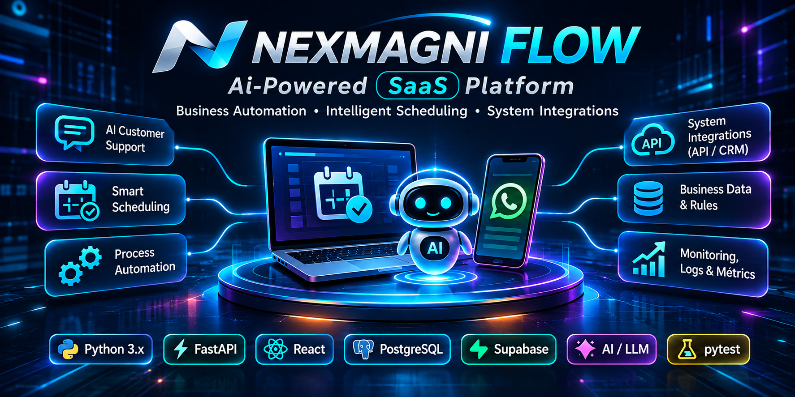
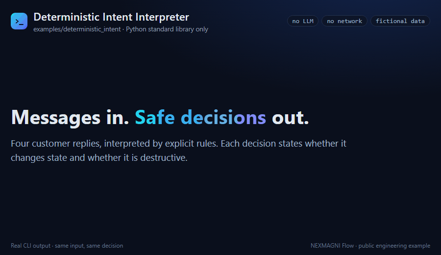
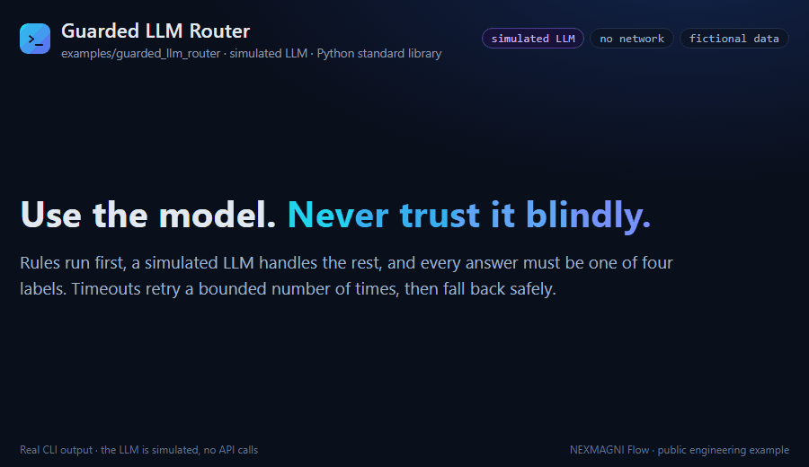
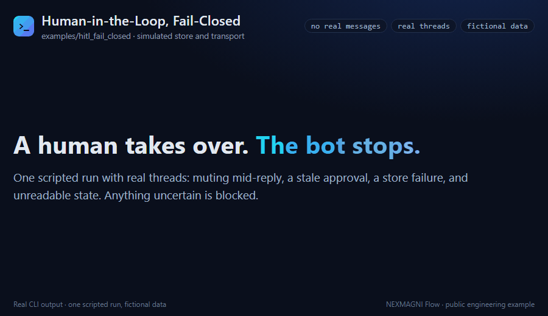
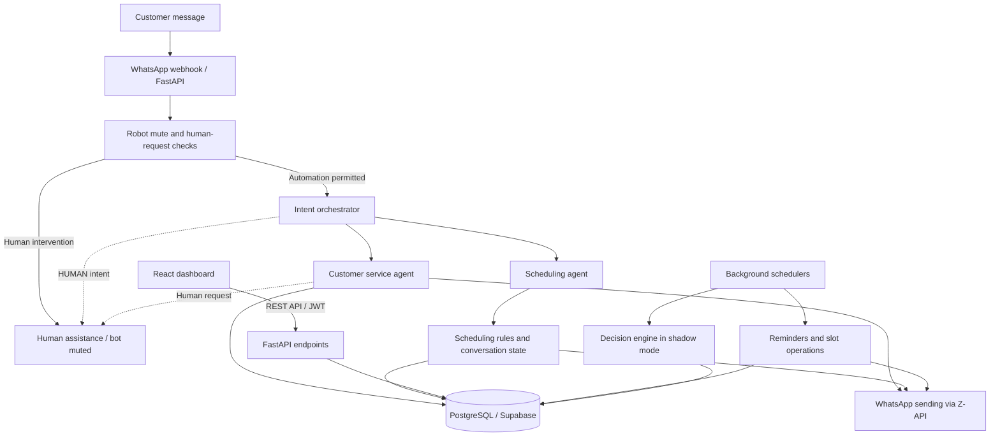
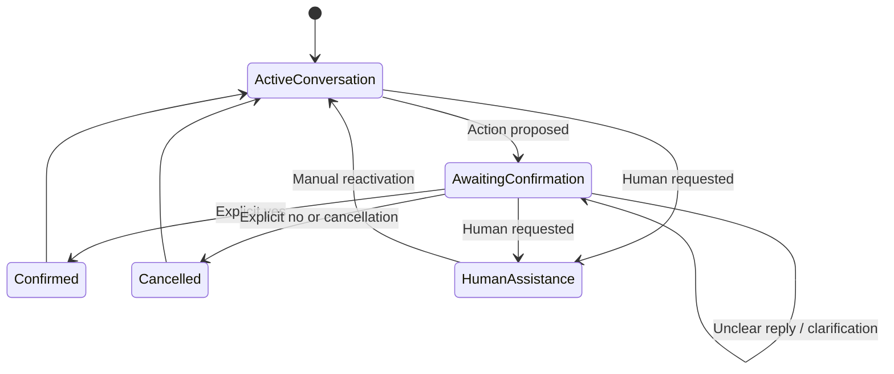
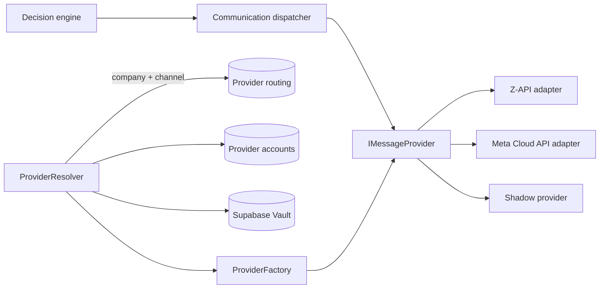

# NEXMAGNI Flow

### AI Automation · Intelligent Agents · Python Backend Engineering

**A multi-tenant SaaS platform for WhatsApp customer service and appointment scheduling, built with Python, FastAPI, React and PostgreSQL.**

NEXMAGNI Flow is a privately developed SaaS application for appointment-based businesses. It combines specialized AI agents, deterministic business rules, transactional scheduling, background automation and human-in-the-loop controls to handle customer conversations and bookings end to end: from the first WhatsApp message to the appointment that appears in the administrative dashboard.

This repository presents the system's architecture and engineering decisions, together with three independent, runnable Python examples that demonstrate selected techniques in isolation.

**Quick links:** [Demos](#demo-preview) · [Python examples](#public-engineering-examples) · [Architecture](#system-architecture) · [Multi-provider messaging](#multi-provider-messaging-architecture)

**Languages:** English (this file) · [Português (Brasil)](README.pt-BR.md)

---

## Engineering Highlights

- **Validated end to end:** WhatsApp integration validated through real customer conversations and appointment bookings, from message to AI agent, PostgreSQL, REST API and React dashboard.
- **Full-stack SaaS:** FastAPI backend with 75+ REST endpoints, a React administrative dashboard and a multi-tenant PostgreSQL/Supabase data model evolved through 17 versioned SQL migrations.
- **Guarded AI orchestration:** LLM-assisted intent routing restricted to a closed set of labels, with deterministic pre-checks, retries and fallback. Business actions remain under application control.
- **Transactional scheduling engine:** rescheduling, schedule closures with conflict preview, automatic slot generation and multi-professional groundwork.
- **Extensible messaging architecture:** provider-agnostic contract with per-company Resolver, Factory, adapters (Z-API, Meta Cloud API, Shadow) and credentials stored in Supabase Vault.
- **Engineering quality:** 2,716 passing backend regression tests in a recorded validation run, and a 500-cycle stress test of the communication decision engine against a real PostgreSQL database with zero duplicate decisions.
- **Public, runnable examples:** three independent Python projects with **1,295 passing tests** of their own, published in [`examples/`](examples/).

## Demo Preview

Short animations generated from the real output of the public Python examples, using fictional data.

**`deterministic_intent`**: confirmation, contradiction, cancellation, and a hypothetical question that triggers no action, rendered from `python -m deterministic_intent` output. Source: [`examples/deterministic_intent/`](examples/deterministic_intent/).

**`guarded_llm_router`**: rules first and a **simulated** LLM (no API calls). A prompt-injection attempt can still only produce one of four labels, repeated timeouts end in a `SERVICE_INFO` fallback, and a request for a person goes to `HUMAN_HANDOFF` without calling the model. Source: [`examples/guarded_llm_router/`](examples/guarded_llm_router/).

**`hitl_fail_closed`**: one scripted run with real threads. A mute during generation blocks the pending reply, a stale approval is rejected, a failed write is reported rather than treated as a block, unreadable state blocks automation, and only a valid human approval reactivates it. Source: [`examples/hitl_fail_closed/`](examples/hitl_fail_closed/).

---

## What I Built

| Domain | Capabilities |
| --- | --- |
| **AI customer service** | WhatsApp webhook processing, intent orchestration, a customer service agent grounded in each business's registered services and prices, and a stateful scheduling agent |
| **Scheduling** | Availability from business hours and breaks, booking, confirmation, cancellation, transactional rescheduling, schedule closures with conflict detection, and a multi-professional data model |
| **Automation** | Automatic slot generation, configurable reminder and confirmation policy per company, quiet hours, follow-ups, no-show risk tracking and a communication decision engine |
| **Customer relationship** | Customer profiles, attendance tracking, and a client recovery queue with states and manual contact tracking |
| **SaaS administration** | Company onboarding with admin approval, service and team management, scheduling views, reports and messaging provider configuration |
| **Governance and security controls** | JWT authentication, separation between company and admin access, audit logs recording before-and-after data and authorship, admin support mode with elevated write authorization, admin-protected technical endpoints, login rate limiting and provider secrets stored in Supabase Vault |

## System Architecture

| Layer | Implementation |
| --- | --- |
| Frontend | React 19, JavaScript/JSX, Vite, Tailwind CSS, TanStack Query, React Router |
| Backend | Python, FastAPI (ASGI), REST APIs, Pydantic, SQLAlchemy |
| Conversational AI | Google Gemini via `google-genai`; intent orchestrator; specialized customer service and scheduling agents |
| Database | PostgreSQL / Supabase, versioned SQL migrations, Supabase Vault |
| Messaging | WhatsApp through the Z-API integration; provider-agnostic messaging layer with Z-API, Meta Cloud API and Shadow adapters |
| Background processing | Reminder scheduler, slot scheduler, communication decision engine (shadow mode) |
| Hosting | Vercel (frontend), Render (backend) |
| Verification | pytest suites spanning routes, services, agents, schema and migrations; real end-to-end validation |

*Conceptual view of the main flows, not a complete call graph. The multi-provider layer is described in its own section below.*

## AI Orchestration and Intelligent Agents

**The model helps interpret; application logic decides what actually happens.**

- **Intent orchestrator:** deterministic checks run first (service names, pricing questions, booking keywords, human requests, active conversation steps). Only then is the LLM asked to classify the message into **four permitted intent categories**. It makes up to **three attempts** with a **one-second wait** between them, and falls back to a safe route when classification fails or returns an unexpected label.
- **Customer service agent:** answers using each business's registered services and prices, and detects requests for a human operator.
- **Scheduling agent:** a stateful, multi-step conversation (service, date, time, confirmation) with a **30-minute session timeout** and anti-loop recovery after repeated failed attempts.
- **Rule-gated actions:** a model-generated response is never treated as a validated business decision. Bookings, cancellations and confirmations go through explicit application rules and database checks.
- **Extended deterministic interpretation (latest iteration, being rolled out):** short replies such as "yes", "no", "cancel", numbered options and responses to reminders are interpreted with explicit rules. Negation, hypothetical wording and ambiguous answers lead to clarification instead of action. Implemented and covered by dedicated tests in the private codebase.

The public [`guarded_llm_router`](examples/guarded_llm_router/) and [`deterministic_intent`](examples/deterministic_intent/) examples demonstrate these patterns with independent code.

## Scheduling Engine and Business Rules

Scheduling is not a single LLM response. It requires continuity across messages, explicit confirmation and consistent data.

*Simplified illustration of the conversational concepts, not the private state machine.*

- **Availability engine:** slots derived from business hours, working days, lunch breaks and service duration, with multi-slot appointments.
- **Transactional rescheduling:** the new booking and the release of the original slot happen atomically, from both the dashboard and WhatsApp.
- **Schedule closures:** global closures block new offers and bookings. A conflict preview lists affected appointments before a closure is created, changed or disabled.
- **Client recovery:** appointments affected by closure conflicts open recovery cases automatically, with tracked states and contact attempts.
- **Multi-professional groundwork:** professionals, services per professional and professional-aware availability in the data model and scheduling services.

## Automation and Background Processing

- **Slot scheduler:** generates and maintains availability automatically per company.
- **Reminder policy per company:** configurable reminder and confirmation lead times, follow-up when a customer does not respond, no-show risk marking and quiet hours.
- **Gradual cutover design:** a newer reminder execution path adds an explicit state machine and claim-based idempotency, governed by a per-company authority switch (`legacy` / `draining` / `new`) so that the new path can take over without duplicate or lost messages.
- **Communication decision engine:** a dedicated engine (context analysis, communication policy, state machine and dispatcher) that decides which message each appointment needs and when. It runs on the deployed scheduler in **shadow mode**: decisions are computed and persisted, and messages are recorded instead of sent, so the engine is validated against real data before it takes over sending.
- **Stress-tested:** 500 consecutive cycles against a real PostgreSQL database produced 0 exceptions, 0 duplicate messages, 0 state regressions and 0 persistence inconsistencies, with stable cycle times.

## Multi-Provider Messaging Architecture

The messaging layer separates business logic from messaging vendors. Outbound communication is modeled through a provider-agnostic contract (`IMessageProvider`) that returns a normalized `ProviderResult` (`SENT`, `PENDING` or `FAILED`), so delivery failures are data, not exceptions.

*Architecture of the messaging layer. Current usage of each path is described below.*

- **Per-tenant provider resolution:** a `ProviderResolver` combines routing (`company + channel → provider`), provider accounts (non-secret configuration) and a secret store backed by **Supabase Vault**. A `ProviderFactory` then builds the concrete adapter.
- **Ports and adapters:** repository and secret-store interfaces with PostgreSQL/Supabase implementations. A composite foreign key prevents a company from referencing another company's provider account, and secret values are masked in object representations.
- **Adapters:**
  - **Z-API**: the WhatsApp integration used in the validated conversation and booking flows, including interactive buttons with automatic plain-text fallback.
  - **Meta WhatsApp Cloud API**: an adapter for text messages built on per-company configuration and Vault credentials, covered by unit tests.
  - **Shadow provider**: records decisions without sending; used by the communication decision engine.
- **Admin tooling:** REST endpoints and a React interface to create, update and rotate provider credentials per company, validated end to end against the production database and Vault.
- **Current usage:** the validated conversation and reminder flows send through the Z-API integration directly. The resolver and factory run in the deployed environment in observation mode, identifying each company's configured provider without sending, and the decision engine dispatches through the Shadow provider. Moving live sending onto the resolver/factory path is the next step of the gradual cutover.
- **Extensibility:** a new provider needs one adapter class and one factory entry. Routing, credential storage and business rules remain unchanged.

## Human-in-the-Loop, Concurrency and Failure Handling

Automation must know when to stop.

**In the deployed application**

- **Human handoff:** explicit requests for a person, detected by rules and by the agents, mute the robot for that conversation. Automated replies resume after reactivation from the dashboard.
- **Transactional integrity:** row-level locking and atomic updates protect bookings, rescheduling and schedule closures.
- **Failure isolation:** the LLM path has retries and safe fallbacks; optional observation paths run inside isolated error boundaries and never interrupt the main reminder cycle; provider adapters return structured results instead of raising on expected delivery failures.

**Latest iteration (implemented and tested, being rolled out)**

- **Fail-closed control:** the robot state is modeled as **active / muted / unknown**. Unknown is treated as blocked, so automation never proceeds when permission cannot be confirmed, and reactivation is exclusively manual.
- **Concurrency:** conversation-level advisory locks in PostgreSQL serialize concurrent messages from the same customer.
- **Pre-send re-check:** the mute state is re-checked immediately before sending, so a human takeover during AI generation blocks the pending reply.

The public [`hitl_fail_closed`](examples/hitl_fail_closed/) example demonstrates the fail-closed state model, per-conversation locking and the pre-send re-check with real threads.

## Engineering Quality and Validation

| Evidence | Result |
| --- | --- |
| Backend regression suite | **2,716 passing tests** in a recorded validation run (September 2026), spanning routes, services, agents, schema and migrations |
| Real end-to-end validation | WhatsApp integration validated through real customer conversations and appointment bookings: message → AI agent → PostgreSQL → REST API → React dashboard |
| Production validations | Company onboarding by admin, provider credential management, and Vault secret creation and rotation validated end to end in the production environment |
| Stress test | 500 consecutive decision-engine cycles against a real PostgreSQL database: 0 exceptions, 0 duplicates, 0 state regressions |
| Database evolution | 17 versioned SQL migrations, schema snapshots and a schema validation tool that compares expected and live database state |
| Auditability | Audit logs with before/after data and authorship for sensitive write operations |

**Engineering practices:** small, reviewable increments with dedicated tests; schema changes delivered through migrations with pre-flight checks; new behavior introduced in observation or shadow mode before it takes authority; production bugs reproduced with regression tests before the fix.

## Public Engineering Examples

The complete application, its proprietary prompts, scheduling rules, internal configuration and production integrations remain private. Three **independently rewritten** examples are published in this repository:

| Example | What it demonstrates | Dependencies | Local tests |
| --- | --- | --- | --- |
| [`examples/deterministic_intent/`](examples/deterministic_intent/) | Yes/no, cancellation, negation, uncertainty and reminder-response classification | Python standard library + pytest | 675 passed |
| [`examples/guarded_llm_router/`](examples/guarded_llm_router/) | Restricted labels, deterministic prechecks, injected fake LLM, retries and fallback | Python standard library + pytest | 432 passed |
| [`examples/hitl_fail_closed/`](examples/hitl_fail_closed/) | Active/muted/unknown states, fail-closed handling, in-memory per-conversation locks, pre-send re-check | Python standard library + pytest | 188 passed |

**1,295 passing tests** across the three examples. They use new code and fictional data, not copied proprietary files. No API keys, external SDKs, live database or paid services are required to run them. The test suites were executed on Python 3.14; Python 3.10+ compatibility was verified syntactically.

See the [Demo Preview](#demo-preview) for animated runs of each example.

## Project Scope

- **Private platform, public examples:** the full NEXMAGNI Flow source code is proprietary. This repository documents its architecture and publishes independent examples of selected techniques.
- **Rollout of recent safeguards:** the three-state fail-closed control, conversation-level locking, pre-send re-check, extended deterministic interpretation and an inbound Meta webhook in observation mode are implemented and tested in the private codebase and are being rolled out to the deployed environment.
- **Messaging providers:** WhatsApp conversations and bookings were validated through the Z-API integration. The multi-provider resolver and factory run in observation mode, and the Meta Cloud API adapter is implemented and unit-tested, ready for channel provisioning.
- **Tenant isolation:** data separation between companies is enforced in the application layer through company-scoped queries. Database-level per-tenant row-level security policies are part of the hardening roadmap.

## Author

**Neusa M.** · Python Backend Developer · AI Automation Engineer · AI Agent Developer

Bachelor of Science in Computer Science candidate at Universidade Cruzeiro do Sul, São Paulo, Brazil. Expected graduation: late 2026. Practical focus on Python backend engineering, FastAPI, API integration, business automation and conversational AI.

- **Email:** [contact.neusam21@gmail.com](mailto:contact.neusam21@gmail.com)
- **GitHub:** [github.com/NeusaM21](https://github.com/NeusaM21)
- **LinkedIn:** [linkedin.com/in/neusam21](https://www.linkedin.com/in/neusam21/)

## License

**All rights reserved.** See [`LICENSE`](LICENSE). No open-source license is granted. Public access to this repository does not itself grant permission to reproduce, modify or redistribute its contents. For permission requests, please contact the author by email.

---

*Portuguese (Brazil) edition: [README.pt-BR.md](README.pt-BR.md).*

  

