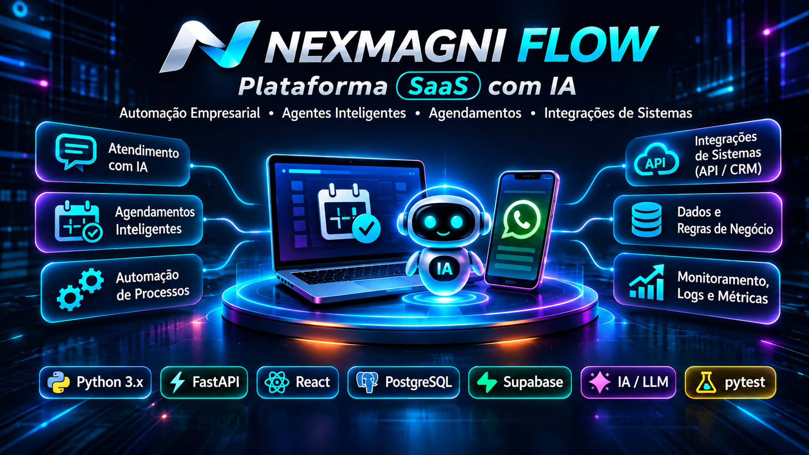
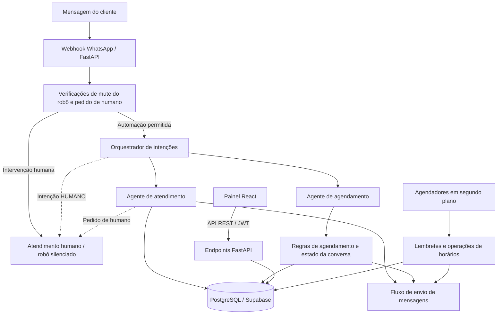
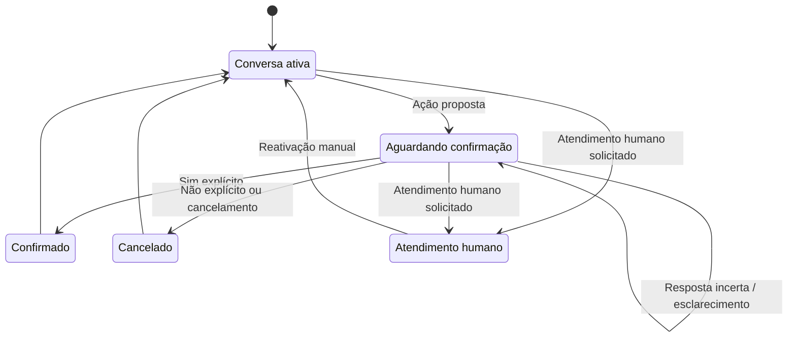
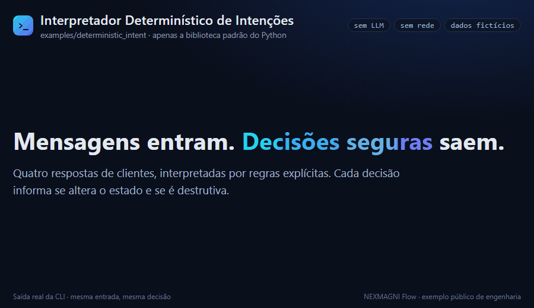
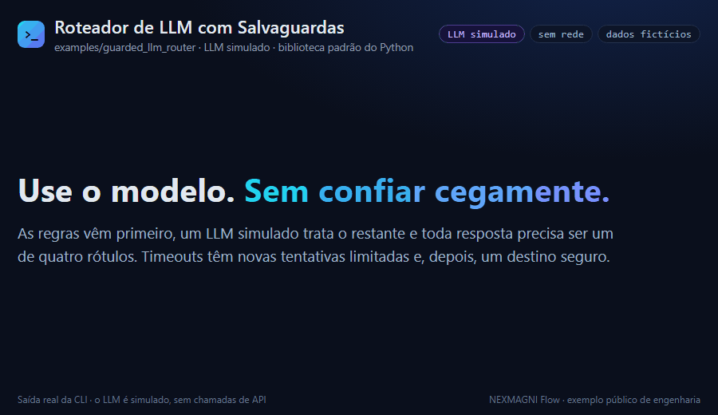

# NEXMAGNI Flow

### Automação com IA · Agentes Inteligentes · Engenharia Backend com Python

**Plataforma multiempresa de comunicação e agendamentos, desenvolvida com Python, FastAPI, React e PostgreSQL.**

O NEXMAGNI Flow é um portfólio de engenharia baseado em uma aplicação SaaS privada, desenvolvida para empresas que trabalham com agendamentos. O projeto demonstra como agentes conversacionais especializados, regras de negócio determinísticas, tarefas em segundo plano e controles de intervenção humana podem atuar em conjunto na automação empresarial.

**Foco de engenharia:** Roteamento de intenções assistido por LLM · Fluxos com estado · Ações condicionadas por regras · Human-in-the-loop · Integrações via API · Testes automatizados

**Escopo do portfólio:** A aplicação completa é privada. Este repositório publica documentação de arquitetura e três exemplos de engenharia independentes, reescritos e testáveis, em [`examples/`](examples/); os materiais visuais revisados continuam planejados. A publicação desses exemplos **não** significa que o SaaS completo esteja operacional em produção.

**Idiomas:** [English](README.md) · Português (Brasil, esta versão).

---

## 1. O que a aplicação faz

A aplicação oferece recursos de comunicação empresarial e operações de agendamento por meio de um painel administrativo e de uma API Python. Entre as funcionalidades implementadas estão:

- **Comunicação com clientes:** atendimento conversacional e fluxos de agendamento.
- **Fluxos de agendamento:** conversas em várias etapas, confirmações, expiração de sessão e recuperação após tentativas repetidas sem sucesso.
- **Administração empresarial:** configuração de empresas e serviços, visualizações de agenda, informações de clientes e interfaces relacionadas a CRM.
- **Automação em segundo plano:** programação de lembretes, geração de horários disponíveis e motor de decisão de comunicação operando em modo sombra (*shadow mode*).
- **Intervenção humana:** detecção de solicitações de atendimento humano e controles para pausar respostas automatizadas.
- **Lógica multiempresa:** filtragem de dados por empresa na aplicação, incluindo `empresa_id`.

A presença de um componente na versão implantada do código **não significa** que todos os fluxos completos tenham sido validados em produção. Consulte [Estado da implementação](#9-estado-da-implementação).

## 2. Arquitetura

| Área | Implementação |
| --- | --- |
| Frontend | React 19, JavaScript/JSX, Vite, Tailwind CSS, TanStack Query, React Router |
| Backend | Python, FastAPI (ASGI), APIs REST |
| IA conversacional | Google Gemini via `google-genai`, orquestrador de intenções e agentes especializados em atendimento e agendamento |
| Banco de dados | PostgreSQL / Supabase, migrações SQL versionadas |
| Mensageria | Integração com WhatsApp; envio direto pela Z-API no fluxo implantado |
| Processamento em segundo plano | Agendadores de lembretes e horários; motor de decisão de comunicação (modo sombra) |
| Hospedagem | Frontend na Vercel; backend no Render |
| Verificação | Testes automatizados em Python e verificações isoladas de componentes |

*Visão conceitual do sistema implantado, não um mapa completo de chamadas. Proteções mais recentes, existentes apenas localmente, como a nova verificação de mute antes do envio e o bloqueio por conversa, são descritas separadamente abaixo. Há uma abstração de provedores no motor de decisão de comunicação; o fluxo de envio implantado utiliza a Z-API diretamente.*

## 3. Orquestração de IA e agentes especializados

**O modelo auxilia na interpretação; a lógica da aplicação controla as ações operacionais.** O orquestrador combina verificações determinísticas com classificação assistida por LLM em **quatro categorias permitidas de intenção**. Ele realiza até **três tentativas**, com **um segundo de espera** entre elas, e utiliza uma rota alternativa (*fallback*) quando a classificação falha ou retorna um rótulo inesperado.

O **agente de atendimento** utiliza informações cadastradas da empresa sobre serviços e preços e detecta solicitações de assistência humana. O **agente de agendamento** gerencia conversas com estado, incluindo **expiração da sessão após 30 minutos** e recuperação após tentativas repetidas sem sucesso.

Esses recursos existem no código implantado. Isso não significa que todos os caminhos de conversa tenham passado por testes completos de aceitação ponta a ponta em produção.

## 4. Interpretação determinística e ações condicionadas por regras

A aplicação implantada já contém verificações determinísticas de roteamento e regras operacionais de conversação. Uma interpretação mais avançada foi desenvolvida posteriormente na versão local do backend:

| Comportamento | Estado |
| --- | --- |
| Verificações determinísticas antes do roteamento e recuperação de sessão | ✅ Implantado |
| Tratamento avançado de negações, frases hipotéticas e respostas ambíguas de sim/não | 🧪 Local, testado; não implantado |
| Interpretação mais precisa de cancelamentos e respostas a lembretes | 🧪 Local, testado; não implantado |

O projeto separa a **interpretação da mensagem** da **permissão para executar uma ação**. Uma resposta gerada pelo modelo não equivale a uma decisão de negócio validada; quando necessário, o sistema utiliza regras explícitas da aplicação.

## 5. Intervenção humana e concorrência

O backend implantado possui um **controle binário para silenciar o robô** e permite a transferência do atendimento para uma pessoa, com **reativação manual pelo painel**. Na versão implantada, a reativação não é exclusivamente manual, pois o código de agendamento também pode remover o estado de silêncio. Essa versão não contém o mecanismo mais recente de três estados com bloqueio preventivo (*fail-closed*).

A implementação local, ainda não implantada, acrescenta:

- Estados operacionais **ativo / silenciado / desconhecido**, com o estado desconhecido tratado como bloqueado.
- Comportamento **fail-closed**, que impede a automação quando a permissão não pode ser confirmada.
- **Bloqueio por conversa** para reduzir conflitos de processamento concorrente.
- **Nova verificação do estado de silêncio antes de enviar** uma mensagem.

Esses recursos estão 🧪 **implementados e testados localmente**, mas não são funcionalidades da versão em produção. Este portfólio público demonstra esses conceitos com exemplos independentes e dados em memória (consulte a [seção 10](#10-exemplos-públicos-de-engenharia)), sem divulgar a implementação proprietária.

## 6. Agendamento com estado e automação em segundo plano

Um agendamento não se resume a uma resposta do LLM. Ele exige continuidade entre mensagens, confirmação explícita, gerenciamento de sessão e coordenação com tarefas em segundo plano.

*Ilustração simplificada dos conceitos de conversação, não a máquina de estados privada de agendamento. O tratamento avançado de ambiguidades mostrado aqui existe apenas localmente (🧪) e não representa uma afirmação sobre o interpretador implantado.*

O backend também contém **agendador de lembretes**, **agendador de horários** e **motor de decisão de comunicação (modo sombra)**. O motor em modo sombra avalia agendamentos e registra decisões de envio de mensagens **sem enviá-las**. Esses componentes têm limites distintos de operação e validação.

## 7. Integrações, separação entre empresas e limites de segurança

- **Mensageria:** o fluxo de envio pelo WhatsApp implantado utiliza a Z-API diretamente. Existe uma abstração mais ampla de provedores no motor de decisão de comunicação (modo sombra), mas ela não é o mecanismo universal de envio implantado.
- **Provedores:** existe um componente para a Meta, porém sua implementação permanece **parcial (🟡)** e não está conectada ao fluxo completo de seleção de provedores.
- **Segredos:** o backend contém um componente de armazenamento de segredos com Supabase Vault. Isso não comprova que todos os valores de configuração estejam protegidos adequadamente em todos os ambientes.
- **Cadastro inicial:** a aplicação contém fluxos de cadastro e configuração de empresas.
- **Filtragem por empresa:** a separação de dados depende principalmente da lógica da aplicação e de filtros por `empresa_id`.

**Limitação importante de RLS:** o RLS está habilitado em **23 tabelas**, mas a configuração auditada **não possui políticas de isolamento entre empresas**, e a conexão do backend pode contornar o RLS. Portanto, seria incorreto afirmar que o RLS atualmente impõe a separação entre empresas. Trata-se de um limite de segurança conhecido, não de uma certificação de isolamento.

## 8. Verificação e evidências de engenharia

A auditoria técnica identificou o seguinte inventário:

| Evidência | Escopo |
| --- | --- |
| **158** arquivos de teste | Inventário de testes do backend |
| **Aproximadamente 2.800** funções de teste | Identificação estática; **nem todas foram executadas ou confirmadas como aprovadas** |
| **613 testes aprovados** | Execuções isoladas relatadas anteriormente na **árvore local do backend**, incluindo alterações pendentes (novembro de 2026); **não representam validação completa de produção** |
| **17** migrações SQL versionadas | Inventário de migrações do banco de dados |

Os exemplos públicos têm suas **próprias** suítes isoladas com pytest, dados fictícios, dependências simuladas, sem credenciais de produção e sem necessidade de rede. Nas execuções locais, todos os testes foram aprovados: **675** (`deterministic_intent`), **432** (`guarded_llm_router`) e **188** (`hitl_fail_closed`), **1.295** no total. Consulte a [seção 10](#10-exemplos-públicos-de-engenharia).

## 9. Estado da implementação

| Indicador | Significado |
| --- | --- |
| ✅ | Presente na versão implantada do código; **não necessariamente validado ponta a ponta em produção** |
| 🧪 | Implementado e testado localmente; não implantado |
| 🟡 | Implementado parcialmente ou limitado a um fluxo não ativo / modo sombra |
| 📂 | Publicado neste repositório (`examples/`) |
| 📋 | Planejado para o portfólio público |

| Capacidade | Estado |
| --- | --- |
| Painel administrativo React e conectividade com a API | ✅ |
| Orquestrador de intenções e agentes conversacionais especializados | ✅ |
| Sessões de agendamento, expiração e prevenção de ciclos repetitivos | ✅ |
| Agendadores de lembretes e horários | ✅ |
| Controle binário de silêncio existente e atendimento humano | ✅ |
| Motor de decisão de comunicação (modo sombra): avalia agendamentos e registra decisões de mensagens sem enviá-las | 🟡 |
| Interpretação determinística avançada de intenções | 🧪 |
| HITL de três estados com fail-closed, reativação exclusivamente manual garantida e verificação antes do envio | 🧪 |
| Bloqueio consultivo (*advisory lock*) por conversa | 🧪 |
| Proteção HMAC recente para webhook da Meta | 🧪 |
| Integração com MetaProvider | 🟡 |
| Três exemplos públicos independentes de código (1.295 testes aprovados) | 📂 |
| GIF da interface revisado quanto à privacidade | 📋 |

As alterações mais recentes do backend ainda não foram implantadas. Suas proteções não devem ser apresentadas como ativas no deploy do Render. A implantação do frontend e as verificações de integridade/conectividade não comprovam testes completos de aceitação de todo o sistema.

## 10. Exemplos públicos de engenharia

A aplicação completa, seus prompts proprietários, regras de agendamento, configurações internas e integrações de produção permanecem privados. Três exemplos **reescritos de maneira independente** estão publicados neste repositório:

| Exemplo | O que demonstra | Dependências | Testes locais |
| --- | --- | --- | --- |
| [`examples/deterministic_intent/`](examples/deterministic_intent/) | Classificação de sim/não, cancelamento, negação, incerteza e respostas a lembretes | Biblioteca padrão do Python + pytest | 675 aprovados |
| [`examples/guarded_llm_router/`](examples/guarded_llm_router/) | Rótulos restritos, verificações determinísticas prévias, LLM simulado injetável, tentativas e rota alternativa | Biblioteca padrão do Python + pytest | 432 aprovados |
| [`examples/hitl_fail_closed/`](examples/hitl_fail_closed/) | Estados ativo/silenciado/desconhecido, fail-closed, bloqueios por conversa em memória e verificação antes do envio | Biblioteca padrão do Python + pytest | 188 aprovados |

**Esses exemplos estão publicados aqui; a publicação não significa que o SaaS completo esteja operacional em produção.** Eles usam código novo e dados fictícios, sem copiar arquivos proprietários. Não são necessárias chaves de API, SDKs externos, banco de dados ativo ou serviços pagos para executar os testes. As suítes de testes foram executadas no Python 3.14; a compatibilidade com Python 3.10+ foi verificada apenas sintaticamente.

### Demonstração

Animações curtas geradas a partir da saída real dos exemplos em Python, com dados fictícios.

**`deterministic_intent`**: confirmação, contradição, cancelamento e uma pergunta hipotética que não dispara nenhuma ação, a partir da saída de `python -m deterministic_intent`. Código: [`examples/deterministic_intent/`](examples/deterministic_intent/).

**`guarded_llm_router`**: regras primeiro e um LLM **simulado** (sem chamadas de API). Uma tentativa de injeção de prompt continua limitada a um de quatro rótulos, timeouts repetidos terminam no fallback `SERVICE_INFO` e um pedido para falar com uma pessoa vai para `HUMAN_HANDOFF` sem chamar o modelo. Código: [`examples/guarded_llm_router/`](examples/guarded_llm_router/).

**`hitl_fail_closed`**: uma execução roteirizada com threads reais. Silenciar o robô durante a geração bloqueia a resposta pendente, uma aprovação vencida é rejeitada, uma falha de gravação é informada em vez de tratada como bloqueio, o estado ilegível bloqueia a automação e somente uma aprovação humana válida a reativa. Código: [`examples/hitl_fail_closed/`](examples/hitl_fail_closed/).

## 11. Prévia da interface (planejada)

A interface administrativa inclui gerenciamento de empresas e serviços, visualizações relacionadas a agendamentos e funcionalidades de CRM. Está prevista uma demonstração curta e silenciosa com **ScreenToGif**, além de capturas de tela selecionadas, após revisão de privacidade quadro a quadro.

Os materiais visuais não deverão expor registros de clientes, e-mails de acesso, telefones, endereços, perfis de redes sociais, credenciais ou outras informações sensíveis. Uma gravação da interface não comprova validação ponta a ponta da automação do backend.

## 12. Desenvolvedora e escopo do repositório

Desenvolvido por estudante do **Bacharelado em Ciência da Computação na Universidade Cruzeiro do Sul, São Paulo, Brasil, com previsão de conclusão no final de 2026**, com foco prático em engenharia backend com Python, FastAPI, integração de APIs, automação empresarial e IA conversacional.

**Foco profissional:** Backend Python · AI Automation Engineer · AI Agent Developer  
**GitHub:** [NeusaM21](https://github.com/NeusaM21)

Este repositório é um **portfólio técnico**, não uma oferta de produto SaaS comercial plenamente operacional. A aplicação completa permanece proprietária e privada.

**Direitos autorais: todos os direitos reservados.** O acesso público ao repositório não concede, por si só, permissão para reproduzir, modificar ou redistribuir seu conteúdo. Qualquer licenciamento futuro dos exemplos independentes será decidido separadamente.

---

*Versão em inglês americano: [README.md](README.md). As duas versões apresentam informações técnicas, indicadores de estado e diagramas equivalentes.*
