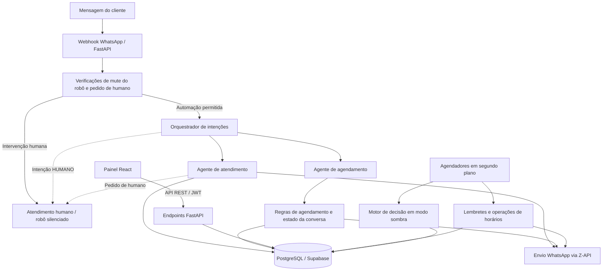
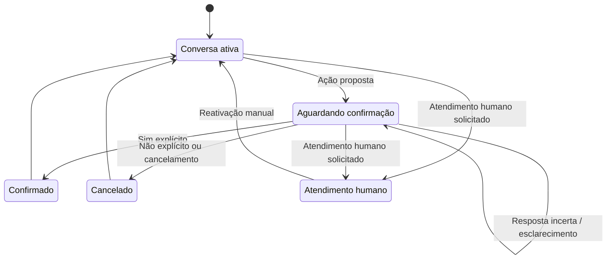
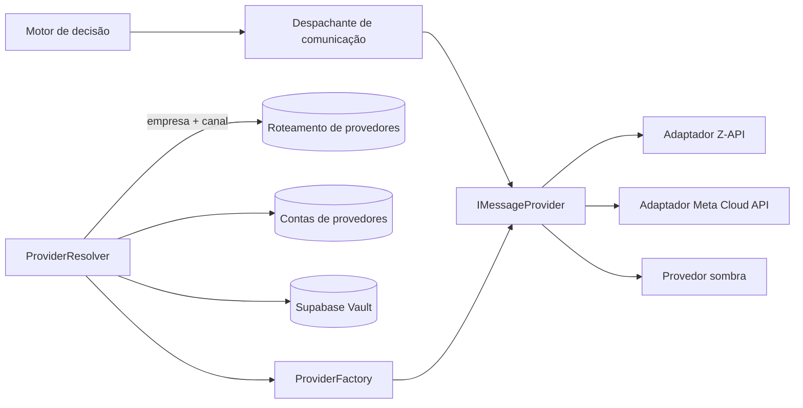

# NEXMAGNI Flow

### Automação com IA · Agentes Inteligentes · Engenharia Backend com Python

**Plataforma SaaS multiempresa para atendimento e agendamentos via WhatsApp, desenvolvida com Python, FastAPI, React e PostgreSQL.**

O NEXMAGNI Flow é uma aplicação SaaS desenvolvida de forma privada para empresas que trabalham com agendamentos. Ela combina agentes de IA especializados, regras de negócio determinísticas, agendamento transacional, automação em segundo plano e controles de intervenção humana (*human-in-the-loop*) para conduzir conversas e agendamentos de ponta a ponta: da primeira mensagem no WhatsApp até o agendamento exibido no painel administrativo.

Este repositório apresenta a arquitetura e as decisões de engenharia do sistema, junto com três exemplos independentes e executáveis em Python que demonstram técnicas selecionadas de forma isolada.

**Links rápidos:** [Demonstrações](#demonstração) · [Exemplos em Python](#exemplos-públicos-de-engenharia) · [Arquitetura](#arquitetura-do-sistema) · [Mensageria multiprovider](#arquitetura-de-mensageria-multiprovider)

**Idiomas:** [English](README.md) · Português (Brasil, esta versão)

---

## Destaques de engenharia

- **Validação de ponta a ponta:** integração com o WhatsApp validada por meio de conversas e agendamentos reais de clientes, da mensagem ao agente de IA, PostgreSQL, API REST e painel React.
- **SaaS full-stack:** backend FastAPI com mais de 75 endpoints REST, painel administrativo em React e modelo de dados multiempresa em PostgreSQL/Supabase, evoluído por meio de 17 migrações SQL versionadas.
- **Orquestração de IA com salvaguardas:** roteamento de intenções assistido por LLM, restrito a um conjunto fechado de rótulos, com verificações determinísticas prévias, novas tentativas e rota alternativa (*fallback*). As ações de negócio permanecem sob controle da aplicação.
- **Motor de agendamento transacional:** reagendamento, fechamentos de agenda com prévia de conflitos, geração automática de horários e base para múltiplos profissionais.
- **Arquitetura de mensageria extensível:** contrato independente de provedor, com *Resolver*, *Factory* e adaptadores (Z-API, Meta Cloud API, Shadow) por empresa e credenciais armazenadas no Supabase Vault.
- **Qualidade de engenharia:** 2.716 testes de regressão do backend aprovados em uma execução de validação registrada, e um teste de estresse de 500 ciclos do motor de decisão de comunicação em um banco PostgreSQL real, sem nenhuma decisão duplicada.
- **Exemplos públicos executáveis:** três projetos Python independentes, com **1.295 testes aprovados** próprios, publicados em [`examples/`](examples/).

## Demonstração

Animações curtas geradas a partir da saída real dos exemplos públicos em Python, com dados fictícios.

**`deterministic_intent`**: confirmação, contradição, cancelamento e uma pergunta hipotética que não dispara nenhuma ação, a partir da saída de `python -m deterministic_intent`. Código: [`examples/deterministic_intent/`](examples/deterministic_intent/).

**`guarded_llm_router`**: regras primeiro e um LLM **simulado** (sem chamadas de API). Uma tentativa de injeção de prompt continua limitada a um de quatro rótulos, timeouts repetidos terminam no fallback `SERVICE_INFO` e um pedido para falar com uma pessoa vai para `HUMAN_HANDOFF` sem chamar o modelo. Código: [`examples/guarded_llm_router/`](examples/guarded_llm_router/).

**`hitl_fail_closed`**: uma execução roteirizada com threads reais. Silenciar o robô durante a geração bloqueia a resposta pendente, uma aprovação vencida é rejeitada, uma falha de gravação é informada em vez de tratada como bloqueio, o estado ilegível bloqueia a automação e somente uma aprovação humana válida a reativa. Código: [`examples/hitl_fail_closed/`](examples/hitl_fail_closed/).

---

## O que eu construí

| Domínio | Capacidades |
| --- | --- |
| **Atendimento com IA** | Processamento de webhook do WhatsApp, orquestração de intenções, agente de atendimento baseado nos serviços e preços cadastrados por cada empresa e agente de agendamento com estado |
| **Agendamento** | Disponibilidade a partir do horário de funcionamento e intervalos, agendamento, confirmação, cancelamento, reagendamento transacional, fechamentos de agenda com detecção de conflitos e modelo de dados para múltiplos profissionais |
| **Automação** | Geração automática de horários, política de lembretes e confirmações configurável por empresa, horário de silêncio, acompanhamentos (*follow-ups*), sinalização de risco de falta e motor de decisão de comunicação |
| **Relacionamento com clientes** | Perfis de clientes, registro de comparecimento e fila de recuperação de clientes com estados e registro de contatos manuais |
| **Administração SaaS** | Cadastro de empresas com aprovação administrativa, gestão de serviços e equipe, visualizações de agenda, relatórios e configuração de provedores de mensageria |
| **Governança e controles de segurança** | Autenticação JWT, separação entre acesso da empresa e acesso administrativo, logs de auditoria com dados anteriores e posteriores e autoria, modo suporte administrativo com autorização elevada para escrita, endpoints técnicos protegidos para administradores, limitação de tentativas de login e segredos de provedores armazenados no Supabase Vault |

## Arquitetura do sistema

| Camada | Implementação |
| --- | --- |
| Frontend | React 19, JavaScript/JSX, Vite, Tailwind CSS, TanStack Query, React Router |
| Backend | Python, FastAPI (ASGI), APIs REST, Pydantic, SQLAlchemy |
| IA conversacional | Google Gemini via `google-genai`; orquestrador de intenções; agentes especializados em atendimento e agendamento |
| Banco de dados | PostgreSQL / Supabase, migrações SQL versionadas, Supabase Vault |
| Mensageria | WhatsApp por meio da integração com a Z-API; camada de mensageria independente de provedor, com adaptadores Z-API, Meta Cloud API e Shadow |
| Processamento em segundo plano | Agendador de lembretes, agendador de horários, motor de decisão de comunicação (modo sombra) |
| Hospedagem | Vercel (frontend), Render (backend) |
| Verificação | Suítes pytest abrangendo rotas, serviços, agentes, schema e migrações; validação real de ponta a ponta |

*Visão conceitual dos principais fluxos, não um mapa completo de chamadas. A camada multiprovider é descrita em uma seção própria abaixo.*

## Orquestração de IA e agentes inteligentes

**O modelo auxilia na interpretação; a lógica da aplicação decide o que de fato acontece.**

- **Orquestrador de intenções:** verificações determinísticas são executadas primeiro (nomes de serviços, perguntas sobre preço, palavras-chave de agendamento, pedidos de atendimento humano, etapas de conversa em andamento). Só então o LLM é acionado para classificar a mensagem em **quatro categorias permitidas de intenção**. Ele realiza até **três tentativas**, com **um segundo de espera** entre elas, e recorre a uma rota segura quando a classificação falha ou retorna um rótulo inesperado.
- **Agente de atendimento:** responde com base nos serviços e preços cadastrados por cada empresa e detecta pedidos de atendimento humano.
- **Agente de agendamento:** conversa com estado e em várias etapas (serviço, data, horário, confirmação), com **expiração da sessão após 30 minutos** e recuperação contra ciclos repetitivos após tentativas sucessivas sem sucesso.
- **Ações condicionadas por regras:** uma resposta gerada pelo modelo nunca é tratada como decisão de negócio validada. Agendamentos, cancelamentos e confirmações passam por regras explícitas da aplicação e verificações no banco de dados.
- **Interpretação determinística ampliada (iteração mais recente, em implantação):** respostas curtas como "sim", "não", "cancelar", opções numeradas e respostas a lembretes são interpretadas com regras explícitas. Negações, frases hipotéticas e respostas ambíguas levam a um pedido de esclarecimento em vez de uma ação. Implementada e coberta por testes dedicados no código privado.

Os exemplos públicos [`guarded_llm_router`](examples/guarded_llm_router/) e [`deterministic_intent`](examples/deterministic_intent/) demonstram esses padrões com código independente.

## Motor de agendamento e regras de negócio

Um agendamento não se resume a uma resposta do LLM. Ele exige continuidade entre mensagens, confirmação explícita e dados consistentes.

*Ilustração simplificada dos conceitos de conversação, não a máquina de estados privada.*

- **Motor de disponibilidade:** horários derivados do horário de funcionamento, dias de trabalho, intervalos de almoço e duração dos serviços, com suporte a atendimentos que ocupam vários horários.
- **Reagendamento transacional:** o novo agendamento e a liberação do horário original ocorrem de forma atômica, tanto pelo painel quanto pelo WhatsApp.
- **Fechamentos de agenda:** fechamentos globais bloqueiam novas ofertas e agendamentos. Uma prévia de conflitos lista os agendamentos afetados antes que um fechamento seja criado, alterado ou desativado.
- **Recuperação de clientes:** agendamentos afetados por conflitos de fechamento abrem casos de recuperação automaticamente, com estados e tentativas de contato registrados.
- **Base para múltiplos profissionais:** profissionais, serviços por profissional e disponibilidade considerando o profissional no modelo de dados e nos serviços de agendamento.

## Automação e processamento em segundo plano

- **Agendador de horários:** gera e mantém a disponibilidade automaticamente para cada empresa.
- **Política de lembretes por empresa:** antecedência configurável de lembretes e pedidos de confirmação, acompanhamento quando o cliente não responde, sinalização de risco de falta e horário de silêncio.
- **Projeto de transição gradual:** um caminho mais recente de execução de lembretes acrescenta uma máquina de estados explícita e idempotência baseada em reivindicação (*claim*), controlado por uma chave de autoridade por empresa (`legacy` / `draining` / `new`), para que o novo caminho assuma o envio sem mensagens duplicadas ou perdidas.
- **Motor de decisão de comunicação:** um motor dedicado (análise de contexto, política de comunicação, máquina de estados e despachante) que decide qual mensagem cada agendamento precisa e quando. Ele roda no agendador implantado em **modo sombra** (*shadow mode*): as decisões são calculadas e persistidas, e as mensagens são registradas em vez de enviadas, de modo que o motor seja validado com dados reais antes de assumir o envio.
- **Teste de estresse:** 500 ciclos consecutivos em um banco PostgreSQL real resultaram em 0 exceções, 0 mensagens duplicadas, 0 regressões de estado e 0 inconsistências de persistência, com tempos de ciclo estáveis.

## Arquitetura de mensageria multiprovider

A camada de mensageria separa a lógica de negócio dos fornecedores de mensageria. O envio é modelado por meio de um contrato independente de provedor (`IMessageProvider`), que devolve um `ProviderResult` padronizado (`SENT`, `PENDING` ou `FAILED`). Assim, uma falha de entrega é tratada como dado, e não como exceção.

*Arquitetura da camada de mensageria. O uso atual de cada caminho é descrito abaixo.*

- **Resolução de provedor por empresa:** um `ProviderResolver` combina roteamento (`empresa + canal → provedor`), contas de provedor (configuração não secreta) e um cofre de segredos baseado no **Supabase Vault**. Uma `ProviderFactory` constrói então o adaptador concreto.
- **Ports e adaptadores:** interfaces de repositório e de armazenamento de segredos, com implementações em PostgreSQL/Supabase. Uma chave estrangeira composta impede que uma empresa referencie a conta de provedor de outra, e os valores secretos são mascarados nas representações dos objetos.
- **Adaptadores:**
  - **Z-API**: a integração com o WhatsApp utilizada nos fluxos validados de conversa e agendamento, incluindo botões interativos com alternativa automática para texto simples.
  - **Meta WhatsApp Cloud API**: adaptador para mensagens de texto baseado em configuração por empresa e credenciais no Vault, coberto por testes unitários.
  - **Provedor sombra**: registra decisões sem enviar mensagens; utilizado pelo motor de decisão de comunicação.
- **Ferramentas administrativas:** endpoints REST e interface React para cadastrar, editar e rotacionar credenciais de provedores por empresa, validados de ponta a ponta no banco de dados de produção e no Vault.
- **Uso atual:** os fluxos validados de conversa e de lembretes enviam diretamente pela integração com a Z-API. O resolver e a factory rodam no ambiente implantado em modo de observação, identificando o provedor configurado de cada empresa sem enviar mensagens, e o motor de decisão despacha pelo provedor sombra. Migrar o envio real para o caminho resolver/factory é a próxima etapa da transição gradual.
- **Extensibilidade:** um novo provedor exige uma classe adaptadora e uma entrada na factory. Roteamento, armazenamento de credenciais e regras de negócio permanecem inalterados.

## Intervenção humana, concorrência e tratamento de falhas

A automação precisa saber quando parar.

**Na aplicação implantada**

- **Transferência para atendimento humano:** pedidos explícitos para falar com uma pessoa, detectados por regras e pelos agentes, silenciam o robô naquela conversa. As respostas automáticas são retomadas após a reativação pelo painel.
- **Integridade transacional:** bloqueio de linhas e atualizações atômicas protegem agendamentos, reagendamentos e fechamentos de agenda.
- **Isolamento de falhas:** o caminho do LLM tem novas tentativas e rotas alternativas seguras; caminhos opcionais de observação rodam em limites de erro isolados e nunca interrompem o ciclo principal de lembretes; os adaptadores de provedores devolvem resultados estruturados em vez de lançar exceções em falhas de entrega esperadas.

**Iteração mais recente (implementada e testada, em implantação)**

- **Controle fail-closed:** o estado do robô é modelado como **ativo / silenciado / desconhecido**. O estado desconhecido é tratado como bloqueado, de modo que a automação nunca prossegue quando a permissão não pode ser confirmada, e a reativação é exclusivamente manual.
- **Concorrência:** bloqueios consultivos (*advisory locks*) por conversa no PostgreSQL serializam mensagens simultâneas do mesmo cliente.
- **Nova verificação antes do envio:** o estado de silêncio é verificado novamente imediatamente antes do envio, de modo que a assunção do atendimento por uma pessoa durante a geração da IA bloqueia a resposta pendente.

O exemplo público [`hitl_fail_closed`](examples/hitl_fail_closed/) demonstra o modelo de estados fail-closed, o bloqueio por conversa e a nova verificação antes do envio com threads reais.

## Qualidade de engenharia e validação

| Evidência | Resultado |
| --- | --- |
| Suíte de regressão do backend | **2.716 testes aprovados** em uma execução de validação registrada (setembro de 2026), abrangendo rotas, serviços, agentes, schema e migrações |
| Validação real de ponta a ponta | Integração com o WhatsApp validada por meio de conversas e agendamentos reais de clientes: mensagem → agente de IA → PostgreSQL → API REST → painel React |
| Validações em produção | Cadastro de empresa pelo administrador, gestão de credenciais de provedores e criação e rotação de segredos no Vault validados de ponta a ponta no ambiente de produção |
| Teste de estresse | 500 ciclos consecutivos do motor de decisão em um banco PostgreSQL real: 0 exceções, 0 duplicidades, 0 regressões de estado |
| Evolução do banco de dados | 17 migrações SQL versionadas, snapshots de schema e uma ferramenta de validação de schema que compara o estado esperado com o estado real do banco |
| Auditabilidade | Logs de auditoria com dados anteriores e posteriores e autoria para operações de escrita sensíveis |

**Práticas de engenharia:** incrementos pequenos e revisáveis, com testes dedicados; mudanças de schema entregues por migrações com verificações prévias; novos comportamentos introduzidos em modo de observação ou modo sombra antes de assumirem autoridade; bugs de produção reproduzidos com testes de regressão antes da correção.

## Exemplos públicos de engenharia

A aplicação completa, seus prompts proprietários, regras de agendamento, configurações internas e integrações de produção permanecem privados. Três exemplos **reescritos de maneira independente** estão publicados neste repositório:

| Exemplo | O que demonstra | Dependências | Testes locais |
| --- | --- | --- | --- |
| [`examples/deterministic_intent/`](examples/deterministic_intent/) | Classificação de sim/não, cancelamento, negação, incerteza e respostas a lembretes | Biblioteca padrão do Python + pytest | 675 aprovados |
| [`examples/guarded_llm_router/`](examples/guarded_llm_router/) | Rótulos restritos, verificações determinísticas prévias, LLM simulado injetável, novas tentativas e rota alternativa | Biblioteca padrão do Python + pytest | 432 aprovados |
| [`examples/hitl_fail_closed/`](examples/hitl_fail_closed/) | Estados ativo/silenciado/desconhecido, fail-closed, bloqueios por conversa em memória e nova verificação antes do envio | Biblioteca padrão do Python + pytest | 188 aprovados |

**1.295 testes aprovados** nos três exemplos. Eles usam código novo e dados fictícios, sem copiar arquivos proprietários. Não são necessárias chaves de API, SDKs externos, banco de dados ativo ou serviços pagos para executá-los. As suítes de testes foram executadas no Python 3.14; a compatibilidade com Python 3.10+ foi verificada sintaticamente.

Consulte a [Demonstração](#demonstração) para ver execuções animadas de cada exemplo.

## Escopo do projeto

- **Plataforma privada, exemplos públicos:** o código-fonte completo do NEXMAGNI Flow é proprietário. Este repositório documenta sua arquitetura e publica exemplos independentes de técnicas selecionadas.
- **Implantação das salvaguardas recentes:** o controle fail-closed de três estados, o bloqueio por conversa, a nova verificação antes do envio, a interpretação determinística ampliada e um webhook de entrada da Meta em modo de observação estão implementados e testados no código privado e em processo de implantação no ambiente publicado.
- **Provedores de mensageria:** conversas e agendamentos pelo WhatsApp foram validados por meio da integração com a Z-API. O resolver e a factory multiprovider rodam em modo de observação, e o adaptador da Meta Cloud API está implementado e coberto por testes unitários, pronto para o provisionamento do canal.
- **Separação entre empresas:** a separação de dados entre empresas é garantida na camada de aplicação, por meio de consultas filtradas por empresa. Políticas de segurança em nível de linha (RLS) por empresa no banco de dados fazem parte do roteiro de reforço de segurança.

## Autora

**Neusa M.** · Desenvolvedora Backend Python · Engenheira de Automação com IA · Desenvolvedora de Agentes de IA

Estudante do Bacharelado em Ciência da Computação na Universidade Cruzeiro do Sul, São Paulo, Brasil. Previsão de conclusão: final de 2026. Foco prático em engenharia backend com Python, FastAPI, integração de APIs, automação empresarial e IA conversacional.

- **E-mail:** [contact.neusam21@gmail.com](mailto:contact.neusam21@gmail.com)
- **GitHub:** [github.com/NeusaM21](https://github.com/NeusaM21)
- **LinkedIn:** [linkedin.com/in/neusam21](https://www.linkedin.com/in/neusam21/)

## Licença

**Todos os direitos reservados.** Consulte o arquivo [`LICENSE`](LICENSE). Nenhuma licença de código aberto é concedida. O acesso público a este repositório não concede, por si só, permissão para reproduzir, modificar ou redistribuir seu conteúdo. Para solicitar permissão, entre em contato com a autora por e-mail.

---

*Versão em inglês americano: [README.md](README.md).*

  

